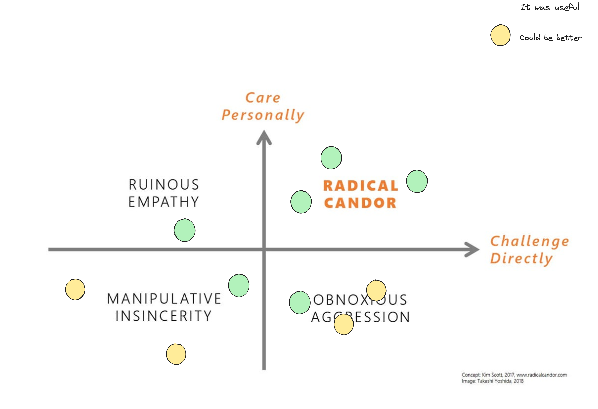
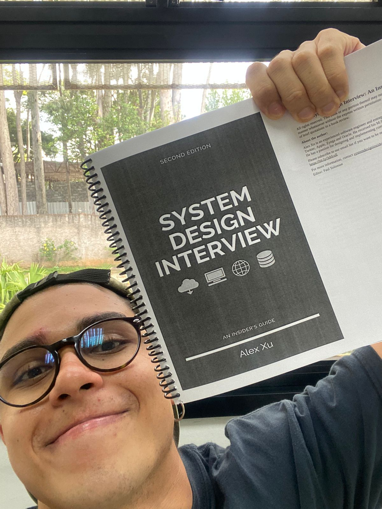

# Books

A collection of books I've read with notes and summaries.

---

## Book List

| Book | Author | Amazon Link |
|------|--------|-------------|
| A Árvore Mais Sozinha do Mundo | - | [Amazon](https://www.amazon.com.br/s?k=A+%C3%A1rvore+mais+sozinha+do+mundo) |
| A Carne | Rosa Montero | [Amazon](https://www.amazon.com.br/s?k=A+carne+Rosa+Montero) |
| A Fé e o Fuzil | Bruno Paes Manso | [Amazon](https://www.amazon.com.br/s?k=A+f%C3%A9+e+o+fuzil+Bruno+Paes+Manso) |
| A Origem da Desigualdade entre os Homens | Rousseau | [Amazon](https://www.amazon.com.br/s?k=A+origem+da+desigualdade+entre+os+homens+Rousseau) |
| A Paixão Segundo G.H. | Clarice Lispector | [Amazon](https://www.amazon.com.br/s?k=A+paix%C3%A3o+segundo+GH+Clarice+Lispector) |
| A Philosophy of Software Design | John Ousterhout | [Amazon](https://www.amazon.com.br/s?k=A+Philosophy+of+Software+Design+John+Ousterhout) |
| A Viena de Freud | - | [Amazon](https://www.amazon.com.br/s?k=A+Viena+de+Freud) |
| Brasil no Espelho | Felipe Nunes | [Amazon](https://www.amazon.com.br/s?k=Brasil+no+Espelho+Felipe+Nunes) |
| Cien Años de Soledad | Gabriel García Márquez | [Amazon](https://www.amazon.com.br/s?k=Cem+anos+de+solid%C3%A3o+Gabriel+Garcia+Marquez) |
| Civilization and Its Discontents | Sigmund Freud | [Amazon](https://www.amazon.com.br/Civilization-Discontents-English-Sigmund-Freud-ebook/dp/B07MPCSC9B) |
| Discurso sobre as Ciências e sobre as Artes | Rousseau | [Amazon](https://www.amazon.com.br/s?k=Discurso+sobre+as+ci%C3%AAncias+e+sobre+as+artes+Rousseau) |
| Dune | Frank Herbert | [Amazon](https://www.amazon.com.br/Dune-Frank-Herbert/dp/0441172717) |
| Educação como Prática da Liberdade | Paulo Freire | [Amazon](https://www.amazon.com.br/s?k=Educa%C3%A7%C3%A3o+como+pr%C3%A1tica+da+liberdade+Paulo+Freire) |
| Eichmann em Jerusalém | Hannah Arendt | [Amazon](https://www.amazon.com.br/s?k=Eichmann+em+Jerusal%C3%A9m+Hannah+Arendt) |
| Esaú e Jacó | Machado de Assis | [Amazon](https://www.amazon.com.br/s?k=Esau+e+Jac%C3%B3+Machado+de+Assis) |
| Felizes por Enquanto | Geni Núñez | [Amazon](https://www.amazon.com.br/Felizes-por-enquanto-Escritos-poss%C3%ADveis/dp/8542228596) |
| Five Lectures on Psycho-Analysis | Sigmund Freud | [Amazon](https://www.amazon.com.br/s?k=Five+Lectures+on+Psycho-Analysis+Freud) |
| Freud - O Infamiliar (Das Unheimliche) | Sigmund Freud | [Amazon](https://www.amazon.com.br/s?k=Freud+O+infamiliar) |
| Freud (1901-1905) - Obras Completas Vol. 6 (Três ensaios sobre a teoria da sexualidade, O caso Dora e outros textos) | Sigmund Freud | [Amazon](https://www.amazon.com.br/s?k=Freud+Obras+completas+Volume+6) |
| Grande Sertão: Veredas | João Guimarães Rosa | [Amazon](https://www.amazon.com.br/s?k=Grande+Sert%C3%A3o%3A+Veredas+Jo%C3%A3o+Guimar%C3%A3es+Rosa) |
| Gregos & Baianos | José Paulo Paes | [Amazon](https://www.amazon.com.br/s?k=Gregos+%26+Baianos+Jos%C3%A9+Paulo+Paes) |
| História da Sexualidade Vol. 1 - A Vontade de Saber | Michel Foucault | [Amazon](https://www.amazon.com.br/s?k=Hist%C3%B3ria+da+sexualidade+1+Foucault) |
| Jonathan Livingston Seagull | Richard Bach | [Amazon](https://www.amazon.com.br/s?k=Jonathan+Livingston+Seagull+Richard+Bach) |
| Learning Go | Jon Bodner | [Amazon](https://www.amazon.com.br/s?k=Learning+Go+Jon+Bodner) |
| Los Vencejos | Fernando Aramburu | [Amazon](https://www.amazon.com.br/Los-Vencejos-Fernando-Aramburu/dp/8490669988) |
| Lugar de Negro | Lélia Gonzalez & Carlos Hasenbalg | [Amazon](https://www.amazon.com.br/s?k=Lugar+de+Negro+L%C3%A9lia+Gonzalez) |
| Luto e Melancolia | Sigmund Freud | [Amazon](https://www.amazon.com.br/s?k=Luto+e+Melancolia+Sigmund+Freud) |
| Malcolm X | Alex Haley | [Amazon](https://www.amazon.com.br/s?k=Autobiography+of+Malcolm+X) |
| Marxismo e a Opressão às Mulheres: Rumo a uma Teoria Unitária | Lise Vogel | [Amazon](https://www.amazon.com.br/s?k=Marxismo+e+a+Opress%C3%A3o+%C3%A0s+Mulheres%3A+Rumo+a+uma+Teoria+Unit%C3%A1ria+Lise+Vogel) |
| Mundo em Disputa | Marcia Tiburi | [Amazon](https://www.amazon.com.br/s?k=Mundo+em+disputa+Marcia+Tiburi) |
| Neuroses and Non-Neuroses | Marion Minerbo | [Amazon](https://www.amazon.com.br/s?k=Neuroses+Marion+Minerbo) |
| Non-Things: Upheaval in the Lifeworld | Byung-Chul Han | [Amazon](https://www.amazon.com.br/s?k=Non-Things+Byung-Chul+Han) |
| Normatividade Vital em Georges Canguilhem | - | [Article](https://www.scielo.br/j/sausoc/a/NK6WVy885ksS9RBr4SWTqsR/) |
| Norwegian Wood | Haruki Murakami | [Amazon](https://www.amazon.com.br/s?k=Norwegian+Wood+Haruki+Murakami) |
| O Caso Schreber | Sigmund Freud | [Amazon](https://www.amazon.com.br/s?k=O+Caso+Schreber+Sigmund+Freud) |
| O Dilema do Porco Espinho | Leandro Karnal | [Amazon](https://www.amazon.com.br/s?k=O+Dilema+do+Porco+Espinho+Leandro+Karnal) |
| O Homem dos Ratos | Sigmund Freud | [Amazon](https://www.amazon.com.br/s?k=O+Homem+dos+Ratos+Sigmund+Freud) |
| O Peso do Pássaro Morto | Aline Bei | [Amazon](https://www.amazon.com.br/s?k=O+Peso+do+P%C3%A1ssaro+Morto+Aline+Bei) |
| Oração para Desaparecer | Socorro Acioli | [Amazon](https://www.amazon.com.br/s?k=Ora%C3%A7%C3%A3o+para+Desaparecer+Socorro+Acioli) |
| Pele Negra, Máscaras Brancas | Frantz Fanon | [Amazon](https://www.amazon.com.br/s?k=Pele+Negra%2C+M%C3%A1scaras+Brancas+Frantz+Fanon) |
| Ponciá Vicencio | Conceição Evaristo | [Amazon](https://www.amazon.com.br/s?k=Ponci%C3%A1+Vicencio+Concei%C3%A7%C3%A3o+Evaristo) |
| Psicologia das Massas e Análise do Eu | Sigmund Freud | [Amazon](https://www.amazon.com.br/s?k=Psicologia+das+massas+e+an%C3%A1lise+do+eu+Sigmund+Freud) |
| Radical Candor | Kim Scott | [Amazon](https://www.amazon.com.br/Radical-Candor-Kick-Ass-Without-Humanity/dp/1250103509) |
| Rasta and Resistance | Horace Campbell | [Amazon](https://www.amazon.com.br/Rasta-Resistance-Marcus-Garvey-Walter/dp/0865430357) |
| Realismo Capitalista | Mark Fisher | [Amazon](https://www.amazon.com.br/s?k=Realismo+capitalista+Mark+Fisher) |
| Seven Concurrency Models in Seven Weeks | Paul Butcher | [Amazon](https://www.amazon.com/Seven-Concurrency-Models-Weeks-Programmers/dp/1937785653) |
| Sobre o Óbvio | Darcy Ribeiro | [Amazon](https://www.amazon.com.br/s?k=Sobre+o+%C3%B3bvio+Darcy+Ribeiro) |
| System Design Interview | Alex Xu | [Amazon](https://www.amazon.com.br/System-Design-Interview-Insiders-English-ebook/dp/B08B3FWYBX) |
| The 48 Laws of Power | Robert Greene | [Amazon](https://www.amazon.com.br/s?k=The+48+Laws+of+Power+Robert+Greene) |
| The Hard Thing About Hard Things | Ben Horowitz | [Amazon](https://www.amazon.com.br/s?k=The+Hard+Thing+About+Hard+Things+Ben+Horowitz) |
| The Pragmatic Programmer | David Thomas & Andrew Hunt | [Amazon](https://www.amazon.com.br/s?k=The+Pragmatic+Programmer) |
| The Site Reliability Engineering | Google | [Free Online](https://sre.google/sre-book/table-of-contents/) |
| The Software Engineer Guidebook | Gergely Orosz | [Amazon](https://www.amazon.com.br/s?k=The+Software+Engineer+Guidebook+Gergely+Orosz) |
| Triste Fim de Policarpo Quaresma | Lima Barreto | [Amazon](https://www.amazon.com.br/s?k=Triste+fim+de+Policarpo+Quaresma+Lima+Barreto) |
| Tudo é Rio | Carla Madeira | [Amazon](https://www.amazon.com.br/Tudo-%C3%A9-rio-Carla-Madeira/dp/6555871784) |
| What You Do Is Who You Are | Ben Horowitz | [Amazon](https://www.amazon.com/What-You-Do-Is-Who-You-Are-audiobook/dp/B07XVPLHV9) |

---

## Summaries

### A Carne - Rosa Montero

Easy to read and good for passing the time. It puts the reader in contact with the old age of a woman who believes she is losing her drive to desire because she is about to turn 60. An interesting reflection on old age.

### A Fé e o Fuzil - Bruno Paes Manso

Crime and religion in 21st-century Brazil.

---

### A Paixão Segundo G.H. - Clarice Lispector

Hard to understand the author's motivation after the middle of the book, analysis on analyses, on analyses. A cockroach becomes a reason for reflection, a shadow, a vase, the dust in the wardrobe.

It reminds me a bit of Manoel de Barros's poetry, which clings to the tiniest things to try to understand the world.

```
Na verdade, na verdade, os passarinhos que botavam primavera nas palavras.

Manoel de Barros
```

The same goes for Clarice, who wraps herself in the solitude of her room, trying to understand and give meaning to her normal and seemingly dull life.

---

### A Philosophy of Software Design - John Ousterhout

In this book, John Ousterhout specifically talks about software decomposition, when is the best time to split code, make it more modular, and what techniques and principles can be taken into account to make these decisions.

A question before continuing: What differentiates a good developer from a great developer?

According to the book "Talent Is Overrated: What Really Separates World-Class Performers from Everybody Else", talent is a mix of a few factors:

* *Deliberate practice*
* *Dedication*
* *Resilience*

In short: working smart, focused, and with clear goals is what makes anyone, not just developers, better at what they do.

#### Chapter 1 - Introduction (It's all about complexity)

* The bigger the program and the more people working on it, the harder it is to manage complexity.
* Complexity will still increase over time. Despite our best efforts, simpler designs allow us to build larger, more powerful systems.
* There are 2 general approaches to dealing with complexity:
  * Eliminate it by making it simpler and more obvious.
  * Encapsulate it.
* Encapsulation is the process of hiding complexity behind a simpler interface. It allows us to build complex systems without having to understand all the details of how they work.

Unlike physical projects (bridges and buildings), software has a different characteristic. What was used in the past was a code production model called the `waterfall model`, which aimed to design the system completely before it was even implemented. As a result, the initial design had many problems that only appeared when implementation began.

Because of these problems, most projects began to adopt agile development, based on incremental software development, where it is emphasized that the first deliveries are just a small piece of a final delivery, which is gradually increased as the product is evaluated by customers.

In other words, incremental development means that the software is never ready; the design happens constantly throughout the life of the project.

#### Chapter 7 - Different layers, different abstractions

If the system contains layers with similar abstractions, this is a red flag that suggests problems with class decomposition. But in some cases this is not a problem, for example:

**Dispatcher**: A component responsible for directing or transferring control, data or tasks to the appropriate component or layer. It selects one of several possible methods and to do that, it needs to have the same signature of the methods it is dispatching to.

**Decorators**

**Red flag**: A pass-through method is one that does nothing except pass its arguments to another method.

#### Chapter 8 - Pull Complexity Downwards

- Usually you have more users than developers. So moving the complexity to the users couldn't be a good idea.
- Move the complexity to the code/class/method, could be noise, but this can save user time/overhead.
- Sometimes we manage complexity through parameters and configuration, but this can be a problem. How will the user know if the 1000 limit size for their LRU cache is better than 1001? Sometimes this freedom is not too good.

#### Chapter 9 - Better Together or Better Apart

Given two pieces of functionality, should they be implemented together in the same place, or should their implementation be separated?

It might appear that the best way to achieve this goal is to divide the system into a large number of small components: the smaller the components, the simpler each individual component is likely to be. However, the act of subdividing creates additional complexity that was not present **before** the division:

* The more components, the harder to keep track of them all.
* Subdivision can result in additional code to manage the components.
* Subdivision creates separation: the subdivided components will be farther apart than they were before subdivision.
* Subdivision leads to duplication.

Indicators that two pieces of functionality are closely related:

* They share information.
* They are used together. Anyone using one of the pieces of code is likely to use the other as well.
* They overlap conceptually. They are part of the same abstraction, or part of the same conceptual model.
* It's hard to understand one without understanding the other.

---

### Civilization and Its Discontents - Sigmund Freud

Reference: [CONSIDERAÇÕES SOBRE O MAL-ESTAR NA CIVILIZAÇÃO](https://slab.uff.br/wp-content/uploads/sites/101/2020/01/Texto_Gizelle_Falbo_selecao2020.pdf)

---

### Discurso sobre as Ciências e sobre as Artes - Rousseau

#### Question: Sciences and arts → Do they purify customs?

#### Recommendations

- Rousseau - Contrato Social
- Kant - Que é esclarecimento
- Pierre Bourdieu
- Pierre Bourdieu - **Os Herdeiros: Os Estudantes e a Cultura**

#### Terms

**Indução** (induction): comes from the Latin *inductio* — "leading" or "bringing in". In philosophy, a method of inferring a conclusion from particular evidence.

**Retificação** (rectification): comes from the Latin *rectificatio* — "act of straightening" or "act of correcting".

**Entfremdung**

**Politesse**: comes from French — "courtesy" or "kindness". It refers to the proper manners and ways of behaving in social situations.

**Exigência de agradar** (the demand to please)

Unnatural customs

**Separação ser/parecer** (separation of being/seeming) x **Aparecer como se é** (appearing as one is)

#### Class 12/01

Rectification of the theory that **the more developed the arts and sciences are, the more elevated the customs are** — Rousseau argues the opposite.

Arts:
- Utilitarian → technique (reading)
- Non-utilitarian → Aesthetics (painting)

Customs: Models of conduct

**Metaphysical subtleties**:
- Law
- Not concrete

**Historical inductions**:
- Facts
- Concrete

> Não se afiliar sem refletir, sobre as posições e costumes de sua época
>
> Não subjugar-se às opiniões da época

Before: Ignorance and barbarism

Transition (1453):
- Culture of ancient Greece
- Renaissance - Sciences, letters and arts

Today: Enlightened

> Em vida social nós dependemos dos outros. Ponto importante para considerarmos um limite da liberdade. Não julgá-la como o limite da sua força.

> Simular virtudes e dissimular defeitos

A split between being and seeming, which operates across all social relations.

> Letras, ciências e artes → corrupção dos costumes

As a consequence, men no longer know each other, and they develop vices:
- No sincere friendship, no well-founded trust
- Suspicion, betrayal, fear
- Vices decorated with the names of virtues (Love = Possession)

**Before and after the sciences and arts:**

- **Egypt**: Before: Conquerors → After: subjugated
- **Greece**: Before: Victors → After: Everyday corruption, enslaved
- **Rome**: Before: Virtue, dominant → After: Degenerate, crimes, subjugated

#### Class 19/01

> Para agradar você precisa satisfazer os prazeres dos outros

This behavior comes from the arts and sciences. The more rustic a man's origin, the freer he is from this way of operating.

Philosophy is a vague knowledge; what motivates its study is **wonder**.

Luxury (superfluous, dispensable things) → (produces) the **arts**

Injustice → Jurisprudence

Tyranny + Wars + Conspiracies → History

Neglect of the homeland + the unfortunate + friends + duties + natural needs → Sterile contemplations.

Does Rousseau have strong arguments? What are strong arguments? In the professor's view:
- Initial condition taken as definitive
- Part taken as the whole
- Imprecision → Impertinence

Sciences, arts and letters are idle, quiet and sedentary occupations.

#### P2 Formation of Philosophical Thought

**1.1. Do the sciences, the arts and letters corrupt or purify customs?**

They corrupt. In the first part of his discourse, Rousseau argues that the dissimulation of virtues and the distancing from man's natural rusticity happen in societies where the sciences, letters and arts grow.

**1.2. From a methodological point of view, what is the meaning of the "historical inductions", that is, what is the relationship between Rousseau's thesis and these "historical inductions"?**

Rousseau seeks to strengthen his arguments with historical examples that have points in common with his argumentative base, especially the social formations of great societies, such as Egypt, Greece and Rome. Using these social formations as examples, he infers that the distancing from customs grew stronger in these cities, precisely because of the dissolution of morality and social values, caused by the expansion of the sciences, arts and letters.

**1.3. From a conceptual point of view, what results do these historical inductions offer to support and make explicit Rousseau's thesis, that is, what were the main characteristics of societies before and after the development of the sciences, the arts and letters?**

It is possible to observe that the societies presented in Rousseau's historical analyses show high and low points in their formation. In particular, the negative points become stronger with the expansion of the CLAs. For example: Rome, which was characterized as a virtuous and dominant society, but became degenerate, subjugated and full of crimes. Another example is Greece, which was a victorious people, but became marked by slavery and corruption.

**1.4. In the Second Part of the Discourse, Rousseau analyzes the sciences, the arts and letters, relating them to customs. What are the main aspects of this analysis?**

Two aspects: in the first, for Rousseau, the CLAs presuppose luxury, and societies formed with this aspect have futile longings — such a social formation cannot decide the direction of customs, since by acting this way they drift further and further from their rusticity and natural behavior in order to be well liked socially, because they need to simulate virtues and dissimulate their defects. As the second aspect, the addiction to producing the CLAs, where Rousseau provokes the question of whether using this generated knowledge actually served to make society a better place or only to feed the ego of the philosophers and scientists of the time.

---

### Dune - Frank Herbert

Pretty fun reading, the english version it's being hard for me.

---

### Educação como Prática da Liberdade - Paulo Freire

#### Terms

- Pauperizar (to pauperize) = to impoverish
- Relevo (relief) = comes from the Latin *relevare*, which means "to lift".
- Círculo de cultura (culture circle) = A teaching unit that replaces the "school", which is authoritarian by structure and tradition.
- Maiêutica (maieutics) = Socratic teaching method, which involves asking a series of questions to help someone go deeper into a topic.
- Filisteísmo (philistinism) = Widely used to refer to a lack of interest in or appreciation for culture, literature, art, music, theater and other forms of artistic expression. It comes from the term "filisteu" (Philistine), the name given to a people who lived in the region of Philistia, in ancient Palestine.
- Celeuma (uproar) = tumult/commotion.
- Sociologia (sociology) = A field of study within the social sciences, dedicated to analyzing the social, cultural and political relations between individuals and groups within a society.
- Oligarquia (oligarchy) = Oligos = small/few | arkhein = to rule/command. Rule by the few.

#### On democracy

The word democracy has its origin in ancient Greece, in the 5th century BC. It literally means: Rule by the people. *demos* = people | *kratos* = power. Democracy was born in Greece, in Athens, and was an inspiration for many democratic movements throughout history. At that time there were assemblies, courts and popular councils, to ensure that the people (adult men) could exercise their right to political power.

This movement was born from the social rise of the Athenian middle class and its dissatisfaction with tyrannical rule, leading them to create a new political system based on the direct participation of citizens.

#### Education and Politics: Sociological Reflections on a Pedagogy of Freedom

It is urgent to teach literacy to and raise the awareness of the impoverished population, which suffers in an unequal and oppressive system.

Paulo Freire's pedagogical vision becomes effective and complete when learners participate critically and freely in their learning process.

For this, the methodological proposal, the culture circle, a teaching unit that replaces the school, comes in as a tool in this process. The authoritarian, banking model of teaching is no longer needed, and it makes room for a popular education movement where, mediated by a coordinator (who is not called a teacher), the dialogue is facilitated.

Another important point in the literacy process is to bring the *generative words* into confrontation, since all learning must be closely tied to becoming aware of one's real lived situation. So, bringing the vocabulary close to the learner is an important tool in the process.

The Circle is a debate group; its central interest is debating language in the social context. Freedom and criticism that cannot be limited to the group's internal relations, but that show up in the **awareness the group gains of its social situation**.

#### Brazilian Society in Transition

- Man is part of his evolutionary process and of the society he lives in.
- Man is not stuck in a stream of time that comes down to today, but is the result of the whole evolutionary process up to his formation.

**Transitivity**: Some who wanted to hold history in place to keep their privileges, and others who want to move history forward, in an almost suffocating movement to win more rights.

The health of this strange democracy lies in the silence of the people. In immobility.

**Subversiveness**: they call it that for threatening order — but which concept of order are we talking about? Every process of historical formation happened through anarchic paths.

In such an unequal society it is almost impossible to live without unleashing intensely emotional forces.

**Assistentialism**: The big problem with assistentialism lies in its anti-dialogue, which, by imposing muteness and passivity on man, does not give him the conditions to develop his consciousness. Without this consciousness it is impossible to see the Brazilian man integrate into his society in transition.

To exist is a dynamic concept. It implies an eternal dialogue of man with man. Of man with the world. Of man with his creator. This dialogue of man with the world is actually debating the problems that plague society.

#### Critical and Naive Transitivity

**Irracionalismo sectário** (sectarian irrationalism) (intolerant) = a stance marked by an irrational and fanatical devotion to certain principles or ideas, implying a refusal to consider or critically evaluate other ideas.

---

### Felizes por Enquanto - Geni Núñez

There is no single way of being or existing in the world, nor a right or wrong way to relate. In fact, beauty lies in coexistences. The narrative craft that Guarani activist, psychologist and writer Geni Núñez builds in *Felizes por enquanto* shows that, beyond what was forcibly taught during so many centuries of colonization, there are indeed other possible worlds, in which things are not thought from binaries, impositions, or constraints. The charm, after all, is in also finding beautiful what is not a mirror.

Her writings, themselves unclassifiable, strip words of their utilitarian function and map a path in which life happens as it is lived, without following a straight line, in a time and memory that are always in motion.

> And, in our smallness of immensity, we get frustrated, we smile, we cry, we love, we desire... Precisely because we are alive. To be moved rather than anesthetized.

---

### Learning Go - Jon Bodner

#### Chapter 6: Pointers

- Zero value equals nil: pointer, slice, maps and functions.
- The `&` is the address operator that returns the address of the memory location.
- `*` is the indirection operator. It returns the pointed-to-value. This is called dereferencing.
- Before dereferencing a pointer, you should check if it is nil. Otherwise you will get a panic.
- Modern software engineering embraces immutability.

```
[I]mmutable types are safer from bugs, easier to understand, and more ready for change. Mutability makes it harder to understand what your program is doing, and much harder to enforce contracts.
```

- Go uses pointers to declare that some variables and parameters are immutable.
- Go developers use pointers to indicate that a parameter is mutable.

#### Chapter 10 - Concurrency in Go

1. People are attracted to concurrency because they believe concurrent programs are faster. Unfortunately, that is not always the case. More concurrency doesn't automatically make things faster.

```
"more concurrency does not mean more speed."
```

2. "Another important thing to note is that concurrency isn't worth using if the process that's running concurrently doesn't take a lot of time. This is why concurrent operations are often used for I/O."

#### Goroutines

- **Process**: An instance of a program that's being run by a computer's operating system.
- **Threads**: A process is composed of one or more threads.

#### Select

The select algorithm is simple: it picks randomly from any of its cases that can go forward; order is unimportant. This is very different from a switch statement, which always chooses the first case that resolves to true. It also cleanly resolves the starvation problem, as no case is favored over another and all are checked at the same time.

```go
select {
case v := <-ch:
    fmt.Println(v)
case v := <-ch2:
    fmt.Println(v)
case ch3 <- x:
    fmt.Println("wrote", x)
case <-ch4:
    fmt.Println("got value on ch4, but ignored it")
}
```

If on the first iteration the channel `v` is "blocked", the Go engine itself selects another available case.

---

### Los Vencejos - Fernando Aramburu

(No notes yet)

---

### Malcolm X - Alex Haley

> Anytime you find someone more successful than you are, especially when you're both engaged in the same business, you know they're doing something that you aren't.

#### New words

- **staggering**: something impressive
- **hip**: when a person is described as hip, it means they're trendy or cool
- **as though**: "I'd go back and serve it as though he were a millionaire" (as if)
- **meant**: "We both knew what he meant" (both know what he tried to say)
- **I scarcely slept**: I wasn't able to sleep
- **reefer**: marijuana cigarette

---

### Mundo em Disputa - Marcia Tiburi

The content of this book lets us glimpse, beyond the abyss, another possible world.

The author criticizes patrirracialcapacitalismo (patri-racial-capacitalism), a set of prejudices that reinforce the domination of groups, so that they do not set themselves against the system.

Among the groups presented:
- Women
- Black people
- LGBT
- Socialists
- Political activists
- Rural activists, among others

One of the provocations that caught my attention the most concerns the fact that we are creating a society that imagines few possible futures and is settled with the reality we have, seeing it as the only possible and existing alternative. For Marcia, this is a project of the system behind capitalism, which commodifies every form of matter, seeping into people's minds and manipulating the way they think.

Those who seek momentum, fighting for life and social causes, are the wretched of the earth. The same ones who developed a sharper perception of the world and who, at the same time, are mutilated by the system for their revolutionary attitudes.

---

### Non-Things: Upheaval in the Lifeworld - Byung-Chul Han

#### From Thing to Non-Thing

This chapter tries to address the transition from the earthly world, where we have access to "real" things, to the digital order, which de-thingifies the world, in the sense that the world is becoming more and more incomprehensible, cloudier and ghostlier. Nothing is palpable and tangible.

The digital order fragments life, in the sense that the information it generates cannot materialize memory or history. The narrative continuity that stretches over long periods of time is what distinguishes history and memory.

Effectiveness and convenience replace truth. Truth here in the sense of something human beings cannot change; it resists all changes and manipulations. The world is lost in the deep layers of neural networks that humans have no access to; this digital utopia constantly produces a smart prison, and surveillance is seeping more and more into everyday life, **in the form of convenience.**

```
Hoje nós corremos atrás de informações sem obter nenhum saber. Tomamos ciência de tudo sem chegar a nenhum conhecimento. Vamos a todos os lugares sem obter nenhuma experiência. Nós nos comunicamos ininterruptamente, sem participar de nenhuma comunidade. Armazenamos imensas quantidades de dados sem buscar memórias. Acumulamos friends and followers sem toparmos com outros. Assim, as informações desenvolvem uma forma de vida sem constância e duração.
```

The man of the future does not act, he plays. His hand, which was a tool of work to carry out actions and materialize things in the world, is now replaced by his fingers. He chooses instead of acting. He presses buttons to satisfy his needs. His life is not a drama that imposes actions on him, but a game.

#### From Possession to Experience

Having or being: "Ter se refere às coisas [...]. O ser refere-se a vivências [...]."

The old maxim of having no longer applies: the more I have, the more I am. The new maxim of experience is: the more I experience, the more I am.

According to the author there is a confusion between **having and being** — one example would be travel, as if it were a ritual of separating from things. But being, in the pure and simple sense, concerns the things of the heart, which demand a strong emotional and libidinal stimulus. Today we want to bind ourselves neither to things nor to people. Bonds are inconvenient. **They reduce the possibilities of experience, that is, freedom in the consumerist sense.**

Now we expect experiences even from consuming things. The informational content of things, like the *image of a brand*, is becoming more important than their utilitarian value, that is, information is becoming more and more important than the material aspects of the product.

Another example is that things and places are less and less a symbol of personality/identity. Identity today is produced through information, the kind that lives on social media.

**se produire = To put on stage. We stage, we perform our identity.**

#### Culture

Cultural sites are establishing themselves as profitable brands.

Culture has its origin in the community; it transmits the symbolic values that make up that community. The more it becomes a commodity, the further it moves from its origin. The commercialization of culture, in turn, pulls the community away from its truth and destroys it, and culture turns into a commodity — and the commodity is its end, along with the community that comes with it.

---

### Norwegian Wood - Haruki Murakami

A little bit tired of just reading things about business, computer science and so on. Trying to read some novels.

---

### O Dilema do Porco Espinho - Leandro Karnal

#### Introduction

Alone we are free, but together we are happier.

- The Ministry of Loneliness, created in the United Kingdom, shows how important this topic is in today's society.
- Loneliness is not about having company or lacking it. You can feel loneliness in both situations.
- Depression: loss of bonds with life and of the will to live.
- We are gregarious beings, that is, we benefit and evolve in groups.
- Some bibliographic references cited that approach loneliness in different ways:
  - *A paixão segundo G.H.* - Clarice Lispector
  - The worst punishment in prison is solitary confinement.
  - When a child does something wrong at school, they are isolated, so that they feel loneliness.
  - When a couple fights, there is the threat of separation, that is, leaving the other alone.
- Love is a way for two lonelinesses to protect each other.
- Aristotle: Solitude creates gods or beasts.

**Goal of the book:** Shed light on all the faces of loneliness, so that we can better understand this behavior.

#### Chapter 1 - It Is Not Good That Man Should Be Alone

Here, a more biblical analysis of loneliness — for example, in the biblical world, to live is to live as a couple.

- What is the ideal distance between being with others and being alone?
- We live in a time when we take pills for virility, for sleeping and even for waking up.
- Society kept changing, so much so that if we analyze the definition of happiness across different eras, we will see that it changed:
  - For the Egyptians, happiness was found in death, because that is when you live eternally.
  - In the Renaissance (1400-1600), happiness was found in the now, in the small things we can do and enjoy while we are alive.

#### Chapter 2

- Before a friend, I truly become who I am.
- Friends are not made overnight.
- The virtual world is more controllable. You can ignore the annoying people.
- **Demiourgo**: Merchants who began to question the aristocratic structure of the Athenian regime, transforming the political structure of the city-state and allowing more people to participate.
- **Shakespeare**: *A tempestade*. There were beings who made people believe in something that did not exist, and controlled reality to manipulate them. Aldous Huxley's *Admirável Mundo Novo* takes its title from this work. A drug to hide sadness or whatever you want to forget or remember.
- Maybe loneliness is not related to occupying a space or being surrounded by people, but maybe to being in control of that space or those people. It is normal for us to create beaches, parks and services that only selected people can go to. **I** can be here, but I don't want you to be, I control what I will eat, where I will sleep, who I will talk to. Could this be a way of controlling loneliness?
- *The Lonely Crowd* - David Riesman
- Rise of narcissistic personality disorder: the person overestimates their own importance and ability, and tends to underestimate other people's abilities.

Normal experiences like a first date, the first day of school or work, going to a restaurant alone, speaking a different language, show how hard it is to live in the real world — there is always a lot of uncertainty, and what society has been showing is that we are more and more distant from these experiences because of the advent of technology.

Real company is good because it is different from me; it causes pain, discomfort, extra knowledge, an experience. **Living in a group is an act of maturity.**

Conclusion: The chapter talks about how the internet creates isolation, where you own all the actions, are everyone's friend and can share your happiness and see other people's happiness, but it feels like a drug, made to feel less lonely, and it fails, because we are creating a society where people lose physical contact and become less resilient to the normal things of life.

#### Chapter 3 - Loneliness, Solitude and Books

- The more conscious you are, the lonelier you are.
- We are strangers to ourselves.

It shows several books where loneliness is the authors' target and how the protagonists or characters in question deal with it.

#### Chapter 4 - The God of Solitude

- Seeing sin and not taking part in it is a form of loneliness.
- God provides a lot to His closest faithful.
- It is easy to believe when you have everything; faith is put to the test in lack (the desert). Maybe that is why Saint Anthony entered a period of solitude/seclusion, to be closer to his faith.
- Nourishing the spirit through denial of the body: whoever does not mortify the body puts their own soul at risk.
- The Judeo-Christian tradition of solitude, where in these moments solitary men seek balance and meaning for their lives.
  - There is a relationship between the desert and this solitude.
  - Temptations start to appear to test faith. But those who make it are rewarded.

Descartes: Distrust yourself, because your wishes may simply be the fruit of your carnal desires.

#### Chapter 5 - The Image of the Solitary: Art and Cinema in Search of the Imagetic

- Loneliness in art.
- No one creates anything alone out of nothing — every process of technique and knowledge is a set of collaborations.
- Even in art, isolation can nourish or destroy the artist.
- *Os conceitos fundamentais da metafísica* - Martin Heidegger: a comparison between inanimate and animate beings. Inanimate beings cannot enjoy the world; animals, like a dog, live seeking to avoid pain and seek more pleasure — they are poor in world. Man, on the other hand, would be world-forming, because he is able to create/explore and give dimension to what is around him.
- Phases of loneliness: it was used to describe missing someone, then a mental condition and even a virtue, related to the ability to know oneself, create and explore one's subconscious.
- The loneliness of someone who lives in the city and the loneliness of someone who seeks a life in the countryside. Loneliness has many faces; it is a direct relationship with a place or with someone's presence. It is something inherent to human beings, which must always be handled with care so it does not become a mental problem or an illness.

Solitude presupposes freedom. Imagine living in a place isolated from everything and everyone: you don't need to fulfill any duty toward society or the environment you are occupying, because there is no one to be bothered by your practices. From the moment we start living in society, this logic stops being valid, because to live in harmony a set of rules and laws needs to be established; otherwise, we would live in chaos.

#### Chapter 6 - The Solitary Ones

- Loneliness in a romantic relationship. Mistakenly believing that life only exists as a couple.
- Monotony and predictability are the fruit of this loneliness for two.
- Loneliness is not the fruit of being alone; it is the distance between the two.
- The loneliness of the elderly, who find it hard to fit into the evolution of the world they live in.
- Michel Foucault - *Vigiar e Punir*

#### Terms

- Seres gregários (gregarious beings)
- Judaico-cristão (Judeo-Christian)
- Sincretismo religioso (religious syncretism)
- Impropérios (insults): insults and offenses.
- Eremita (hermit): a person who lives in solitude. (Hermits live in the solitude of the desert.)
- Mortificação do corpo (mortification of the body)
- Monashios: solitary people who seek God.
- Idiossincrasia (idiosyncrasy): a characteristic specific to an individual or group. (Idio = own, peculiar; Synkrasis = mixture.)
- Meandros (meanders): disguises, detours, subterfuges.

---

### Radical Candor - Kim Scott

- Sometimes you don't need an app to solve a real problem. Sometimes you just need a face-to-face conversation.
- If it's hard to say to someone that he/she has something between his/her teeth, it's even harder to say that he/she isn't doing a good job.
- A leader that puts attention on the guys that have more chances to standout is not doing a good job.
  - A team is built by a balance between stars and superstars.
    - Superstars are the ones that have a lot of potential — those will be able to lift up the whole team.
    - Stars are the ones that are happy with their job, but not accommodated. They are the ones that will keep the team running.
- The good relation between boss and employee is a result of the Silicon Valley culture. There, if you aren't happy with your job, there are a lot of other companies that will be happy to have you.
- Fun fact: Tim Cook, after discovering Jobs' cancer, proposed to donate a part of his liver to Jobs.

#### Good bosses

What are the responsibilities of a good boss? They are responsible for the results.

1) Guide the team to the goals of the company.
2) Contract, restructure and keep motivated the right guys for the right job.
3) Harvest the results of the team.

In other words, a good boss is responsible to create + contentment and − insatisfaction.

- Good results come from good relationships. Don't try to extract the best from a team that doesn't have synergy.

```
Radical Candor = True care about peers + Willingness to challenge them.
```

- Difference between discussion and dialogue. Is your team able to discuss hard topics without getting sad/angry? Good engineers are able to do that.
- Radical candor varies with the company, culture, and the person. Adapt your approach before any move.
- Direct confrontation for some may sound like a personal attack. But any good thing can be built without a good confrontation of ideas.
- To keep winning you have to criticize the victories. *The problem to live in the top of the mountain is that you can't see the mountain.*

#### Knows what motivates each member of the team

- **Stars**: Being an artist doesn't mean you want to have a gallery of art. Some coworkers are happy with their functions, they love what they do, and they keep the wheel spinning.
- **Superstars**: They have high ambition, they are building things, proposing, discussing, and they will lift up the whole team.

If I say that a member is stable, how does this sound to you? This chapter brings to me a different perspective about the word "stable". I always thought that this word was related to someone that is not ambitious, but these guys are very important to keep everything running. The goal of the boss is to identify them and keep each one motivated based on their goals and ambitions.

- Try to find some purpose in your work. If you ask a mason who was responsible for building São Pedro's Cathedral — the first can say he was working. The second, helping to raise a wall. The third, building a cathedral. The last one, building a cathedral that will be a reference for the next generations.
- Learning to tell your story is a good skill to have.
- Promoting the wrong guys can trigger a series of problems, like team discontentment.

#### Feedbacks

The boss inherits a lot of assumptions, mainly if he/she is a new member in the team. The goal of this fella is to conquer the trust of their mates. Feedbacks are the best way to do that. The feedback, when well done, can propel your career.

- Instead of: "There is something that I can do to help you?"
- Say: "There is something that I can do to help you? According to our last conversations and the things that you have been claiming, I think that you are having some problems with X and maybe Y would be a good idea to fix it."
- Managing reactions to bad feedback.
- **Box of critics**: The head of a company realized that at each meeting, his employees did not feel comfortable about the outcomes of the meeting. His idea was to set up an anonymous feedback box and use this as a tool to improve interaction between employees.
- If you are not able to give sincere feedbacks, your subordinates won't.
- Give feedbacks with actions. Otherwise, it might sound like a personal attack.
- Give the feedback immediately.
- Praise in public, criticize in private. The praise in public should be done as a way to elevate the barrier of the other ones.
- In the criticize chances, don't blame the other by the actions but the outcome that it can generate.
- "I think that this is wrong" > "You are wrong".
- Monitoring your feedbacks is the best way to keep them worth and improve them in the long term.
- Use the Kim Scott map as reference. Share it with your subordinates and ask them to choose how was the last interaction.



---

### Rasta and Resistance - Horace Campbell

How the Rasta movement is going against the materialism, money and capitalism standards.

- Even being a very structured and advanced society we are still creating barriers and walls that define the capacity of someone based on their race or religion.

#### Words

- Hedge - to fence in, protect, limit
- Bondage - slavery
- Held - hold - to grip, keep
- Breakthroughs - advances

#### Who is Marcus Garvey?

Marcus Garvey was a Jamaican political leader, publisher, journalist, entrepreneur, and orator.

#### References

- [Rasta and Resistance - Horace Campbell (YouTube)](https://www.youtube.com/watch?v=M_b72mXDgj4&ab_channel=KONNECTIONSNC)

---

### Seven Concurrency Models in Seven Weeks - Paul Butcher

```
If you've spent hours wrestling with difficult-to-diagnose threading bugs, it might be hard to believe, but a concurrency solution can be simpler and clearer than its sequential equivalent when written in the right language with the right tools.

Paul Butcher
```

#### About the Author

Has a PhD in languages for parallel and distributed computing.

#### The book objective

I like authors that try to be clear of what is the objective of the work that they are putting in the lines. Paul surprised me at the beginning.

Butcher starts by arguing the way that hardware, software complexity, concurrency-driven multi-core architecture, and functional programming languages would begin to emerge and would shape the way we program.

And that in the end we will cringe after knowing how thread-lock — the widely used concurrency solution — works. Besides that, the objective of the book is to make the reader self-sufficient to be able to choose the right concurrent model for solving specific problems.

> The primary driver behind this resurgence of interest is what's become known as the "multi core crisis." Moore's law continues to deliver more transistors per chip, but instead of those transistors being used to make a single CPU faster, we're seeing computers with more and more cores.
> ...
> These days if you need to exploit multiple cores, and that means exploiting parallelism. — Paul Butcher

#### Related but different

```
Concurrency is about dealing with lots of things at once. Parallelism is about doing lots of things at once.
```

The work that our mother does, paying attention to a lot of things while she is trying to make food, we can call `concurrency mother work`. If you have two mothers doing the same work, then it can be called `parallelism mother work`.

**What do parallelism and concurrency have in common?** Both go beyond the traditional sequential programming model in which things happen one at a time, one after another.

#### Nondeterministic / Deterministic

Concurrent programs are often `non-deterministic` — they will give different results depending on the precise timing of events. If you're working on a genuinely concurrent problem, `non-determinism` is natural and to be expected. Parallelism, by contrast, doesn't necessarily imply `non-determinism`.

#### Threads and Locks

```
Threads-and-locks programming is like a Ford Model T. It will get you from point A to point B, but it is primitive, difficult to drive, and both unreliable and dangerous compared to newer technology.
```

**Mutual exclusion**: trying to use the threads-lock model to ensure that only one thread can access data at a time. This behavior can go wrong, including *race conditions* and *deadlocks*. We avoid this through locks, which can be held by only a single thread at a time.

#### Perils of threads and locks

- Race conditions
- Deadlock
- Memory visibility

#### Functional Programming

> Functional programming is like an electric car, advanced, futuristic and not yet widely used, but it's what we'll all rely on in twenty years.

**Mutable state**: A state is basically a variable assignment, and it can be slipped into different types, like mutable — if this **state** can be modified from different parts of the code.

##### Perils of mutable state

- **Hidden mutable state**: variables that affect the behavior of your code, but are hard/impossible to spot while it's happening. Some languages enable it, making it easy to commit dumb mistakes and crash your codebase.
- **Escaped mutable state**: escapology is the practice of escaping from restraints or traps. In this case, the code looked thread-safe, maybe you had some functions that when called by a different thread could trigger a concurrent modification exception, even if this isn't clear in the code.

---

### Sobre o Óbvio - Darcy Ribeiro

In a mocking and relaxed critique, Darcy Ribeiro describes in a few pages the process of colonization in Brazil and the Portuguese empire's lack of interest in promoting a culture of social growth; the empire in turn used political tools to intentionally promote the extraction of wealth from Brazilian soil and the dismantling of the society that was forming here, benefiting and promoting the accumulation of wealth in the class he calls: the ruling class.

#### Part One

Darcy openly brings up popular opinions from the colonial era that were widely spread and that are still reflected today in how our society forms opinions about our social formation:

- Black people are inferior to white people;
- The poor live off the rich;
- We Brazilians are an inferior people, a second-world country.

He tries to refute these atrocities, showing how the effort of the emperors of the time to spread such opinions worked as a modus operandi, with a purely political bias.

Among the practices and foundations used:

- "Somos 100 anos mais velhos que os estadunidenses, mas eles hoje estão muito adiante."
- The use of "Baroque Catholicism", introduced by the Portuguese Jesuits during the colonial period with the goal of catechizing the Indigenous peoples.

And finally, that the ones to blame for our underdevelopment are ourselves, or rather, part of ourselves. That by creating mechanisms to keep the people hungry, uncouth and ugly, a barrier was placed on their development, and behind this, a clear goal: to enrich their families by appropriating Latin American wealth, using slave/Indigenous labor.

#### Part Two

Darcy, also in a casual tone, criticizes the ruling class, showing that the reason for what happened here regarding the highly prosperous model of society and economy was well-founded ideas, and that nothing that formed here happened at random.

The ruling class founded a system with no sentimental appeal to the Brazilian people, benefiting only the masters of the time. Such a system compelled the people to produce what they did not consume, to export abroad.

```
É importante, indispensável e patriótico ter paciência, esperem um pouco, não sejam tão imediatistas, o bolo precisa crescer para que a parte de todos seja maior.
```

Fundamentally, the arguments that reinforce this Machiavellian way of handling Brazil's formation, according to Darcy, show up in a few forms:

- The arrival of the Portuguese royal family in Brazil, with more than 15 thousand servants, who already had a bureaucratic system and the materialization of homogeneous layers that favored the European ruling class, who logically would not come to Brazil with the intention of cultivating a social formation.
- The extraordinary ability to confront and blindfold all social revolutions.
- Laws, like the Land Law (Lei de Terras), which openly established that land in Brazil could only be obtained by purchase.
- Industrial revolution/abolition of slavery. The slave model was so sustainable that, even after the invention of machines — whose sole and exclusive goal was to replace manual labor with machines — it was only formalized in Brazil after the abolition of slavery, and Brazil was one of the last countries in the world to adopt such a law.

#### Part Three

Serving interests: large-landowner appropriation and popular ignorance.

- Basic education: Catholic/state-run.
- Universities in Brazil: dozens of universities in Spanish-speaking Latin America were created from 1550 on. In Brazil, those who had money sent their children to study in Coimbra.

---

### System Design Interview - Alex Xu



---

### The 48 Laws of Power - Robert Greene

For the author, to achieve power and be recognized by others, society, friends and bosses, you need to dissimulate your virtues and sometimes act like an asshole. That way of thinking goes against my principles, so I decided to discontinue the reading.

---

### The Hard Thing About Hard Things - Ben Horowitz

A very good history of the entrepreneur life of Ben Horowitz and the development of the tech industry.

#### Turn your shit in

```
"Some of you guys will come out here and you just won't be serious. You'll get here and start shooting the shit, talking shit, bullshittin', not doing shit, and just want to look good in your football shit. If you do that, then you know what? Turn your shit in." He went on to elaborate on what was unacceptable: "Come late to practice? Turn your shit in. Don't want to hit? Turn your shit in. Walk on the grass? Turn your shit in. Call me Chico? Turn your shit in."
```

#### A good place to work

What is the difference between good and bad organizations?

In good organizations, the employees are sure that working hard will deliver some value and help someone. If they wake up earlier, put in some effort and stay motivated to deliver some value, they will be satisfied with the environment. In bad companies this isn't true.

#### Summary

- Flowers are very cheap, but they can avoid the big problem, a divorce (try to find an easy path thinking in avoiding big problems).
- Marc Andreessen, 22 years old, was the Cofounder of Netscape.
  - Mosaic: the first browser, created by him.
  - Netscape was the company that created JavaScript, cookies and SSL.
- The LoudCloud era. One of the first cloud computing products. Started in 1999.
- "IF YOU ARE GOING TO EAT SHIT, DON'T NIBBLE" — the gains from omitting something and trying to minimize the damage most of the time have the same gains from being direct.

---

### The Pragmatic Programmer - David Thomas & Andrew Hunt

#### The pragmatic philosophy

**Topic 1: It's your life**

Take ownership of your ideas, analyze everything very carefully, it's your life.

**Topic 2: The cat ate my source code**

When taking on responsibilities, try to be as detailed as possible. Be assertive in your answers and try to provide alternatives to the questions asked. Sometimes the only way to find the answers is by reading the source code. Yes, it's horrible, but there are so many variables passed from person to person that often that's what we should do.

**Topic 3: Software Entropy**

- Entropy
- Broken window theory
- Hopelessness can be contagious
- Fix each one as soon as it is discovered

**Topic 4: Stone Soup and Boiled Frogs**

- Eventually, everyone wins.
- Start-up fatigue: the point where the team is so tired that they can't see the light at the end of the tunnel.
  - The solution: try to cook a stone soup. Start putting a small amount of carrots, after that ask for potatoes, and so on.
- The Boiled Frogs: if you put a frog to cook and gradually increase the temperature, in the end it will end up cooked without even realizing what happened to it.

**Topic 5: Good-enough software**

- If your users are happy enough, you're done.
- Involve everyone in the process and in the tradeoffs.
- Most users prefer rough edges today than wait a year for the shiny.
- Know when to stop.

**Topic 6: Your knowledge portfolio**

- Your ability to learn is the most important skill you have.
- Managing your knowledge portfolio is similar to managing your financial portfolio:
  - Investing is habit.
  - Diversification is the key to long-term success.
  - Smart investors balance their portfolios between conservative, high-risk, and speculative investments.
  - Buy low and sell high.
  - Review and rebalance your portfolio periodically.
- Goals:
  - Learn at least one new language every year.
  - Read a technical book each quarter.
  - Read nontechnical books too.
  - Take classes.
  - Participate in local user groups.

**Topic 7: Communicate**

- Make it look good. Your ideas are important. They deserve a good-looking vehicle to convey them to your audience.
- Choose the right moment. Asking for a salary raise when your boss isn't in a good mood doesn't seem to be a good idea.
- Plan what you want to say. Writing it down helps a lot.
- Involve your audience. Public documents and public threads always help to involve everyone.
- Write documentation to avoid duplicate work and be assertive about tough decisions that were made.

---

### The Site Reliability Engineering - Google

#### Chapter 6: Monitoring distributed systems

#### Why Monitoring?

It's impossible to measure the efficiency of something that isn't being monitored.

- Analyze long-term trends
- Compare
- Alerting

The above three reasons are the main reasons to monitor your system. Be able to compare the current state and have some visibility of what is going on — being less reactive and more proactive.

#### Symptoms vs causes

The **what is broken** indicates the symptom, the **why** the possible cause.

- **Symptom**: The site is slow → **Cause**: The database is overloaded.
- **Symptom**: We are receiving 500 errors from our API → **Cause**: The API is down/overloaded.

#### Blackbox vs whitebox monitoring

**Blackbox**: a macro view of your system. You don't know what is happening with details, but you know that something is wrong. Isn't too useful for imminent problems.

**Whitebox**: detailed logs and instrumentation of specific components.

#### The Four golden signals

Basic metrics that you should pay attention to:

- **Latency**: The time it takes to service a request.
- **Traffic**: The amount of requests your system is receiving.
  - For an API, it could be the number of requests per second.
  - For an audio streaming service, the I/O bandwidth.
  - For a database, the number of transactions per second.
- **Errors**: The number of failed requests.
- **Saturation**: How "full" your system is.

#### Worrying About Your Tail

**Mean is not a good metric for distributed systems**, because it can hide the real problems. A good approach to deal with that is to use percentiles. Put metrics **related to time** or **consumption** into some buckets and analyze them.

#### Resolution / Granularity

The granularity of the data you are collecting is also important. If you choose a very high granularity (a lot of data per second), you will overload your systems and increase the costs a lot.

#### Conclusion

After gathering all these concepts and putting them in production, some simple questions should be answered:

- Can I take action in response to this alert?
- Does this alert definitely indicate that the user is being affected?

---

### Triste Fim de Policarpo Quaresma - Lima Barreto

#### Words

- Misantropo (misanthrope): the opposite of a philanthropist, aversion to or hatred of human beings.
- Bongada: to get beaten, to take a hit.
- Capadócio: a rogue, a trickster.

> O que o patriotismo o fez pensar, foi num conhecimento inteiro do Brasil, levando-o a meditações sobre os seus recursos, para depois então apontar os remédios, as medidas progressivas, com pleno conhecimento de causa.

> Não queira levar ao ridículo aqueles que trabalham em silêncio, para a grandeza e a emancipação da Pátria.

---

### Tudo é Rio - Carla Madeira

With a mature, precise yet delicate and poetic narrative, the novel tells the story of the couple Dalva and Venâncio, whose lives are transformed after a tragic loss caused by the husband's morbid jealousy, and of Lucy, the most depraved and coveted prostitute in town, who crosses their path, forming a love triangle.

---

### What You Do Is Who You Are - Ben Horowitz

> A cultura é aquilo que você recompensa ou aquilo que você proíbe.

#### Introduction

```
The culture of a company is what your coworkers do when you are not there. It's the way that they behave when you are not watching, and the path that they choose when they have to make a decision.
```

The author gives some examples of companies in the 90s that have a great culture. The ones that catch my attention are:

#### FairChild Semiconductor (1960s)

The company has the mentality of "Get the barriers out of the way and let people do the things they do well". This creates a culture of innovation — everyone was in charge. If a researcher had an idea, he could pursue it for a year before anyone would start inquiring about results. Employees were encouraged to take risks, and companies like Raytheon Semiconductor, Signetics, General Microelectronics, Intersil, AMD, and Qualidyne were founded by former Fairchild employees.

#### Wikipedia

When it was created, the idea that the public could edit the content that talks about any subject was a crazy idea. Why not trust the PhDs to write the content? Today Wikipedia is considered a unique source of information and the most complete encyclopedia in the world.

#### Intel

Founded by Gordon Moore (coiner of Moore's Law) and Robert Noyce (CEO of Fairchild), they followed a different approach to spread the culture across the company, including the culture that instigates innovation. Everyone worked in one big room with partitions separating them. There was no layer of vice presidents and directors, and Noyce gave the engineers substantial stock options — this guaranteed that they acted like owners and kept the culture of innovation.

In the end, companies that punish failure will never innovate. If everyone thought like that, Silicon Valley would never exist, because that was where the idea of failing to build something new was born.

> Virtues and values are not the same thing. Virtues are the things that you do, and values are the things that you believe.

#### Objective of the book

The book takes you on a journey through culture, from ancient to modern. Along the way, you will learn how to answer a question fundamental to any organization: who are we? A simple-seeming question that's not simple at all. Because who you are is how people talk about you when you're not around. How do you treat your customers? Are you there for people in a pinch? Can you be trusted?

Who you are is not the values you list on the wall. It's not what you say at an all-hands. It's not your marketing campaign. It's not even what you believe. It's what you do.

#### Culture and Revolution: Toussaint Louverture

##### Who was Toussaint Louverture?

- Born in 1743, in the French colony of Saint-Domingue, now Haiti.
- He spent his free time reading and learning, including Julius Caesar's *Commentaries* and Abbé Raynal's *History of the Two Indies*.
- He was liberated in 1776 because his owner recognized that he was a smart guy.
- He started to perceive that what made the behavior of his brothers and sisters wasn't related to the color of their skin, but the culture they absorbed. He started, for example, to buy slaves of his own and give them freedom.

```
"A courageous chief only is wanted. Where is he, that great man whom Nature owes to her vexed, oppressed, and tormented children? Where is he?"
```

##### Louverture's Rise

The fight was against the French, that was facing some problems with the [revolution in France](https://www.britannica.com/event/French-Revolution/Events-of-1789), which opened opportunities for countries like Spain and England to try to take control of the island. In the beginning, Louverture combined forces with the Spanish, but after some time, he realized that they had the same behavior as the French — two other fights were started and won by Louverture.

##### How Louverture reprogrammed slave culture

Changing the culture of a group that already exists isn't an easy task. Louverture permeated the culture that already exists, like religion and cults, to change the way that the slaves think about the world.

He also built a group of the most skilled guys, and gave them the training to be leaders and fighters. They used combat techniques that always surprised the enemies, like using the jungle to hide and attack, using Voodoo signs to communicate over the closest forests.

##### Creating Shocking Rules

Louverture created a rule that was very shocking for the team: slaves could not have other relations if it wasn't with their wives. *If you can't control your oath, how can you control a whole community?*

##### Incorporating outside leadership

Using outside leaders to help build your own culture could sound like a bad idea, but Louverture used the French and Spanish leaders, keeping their roles but now obeying him. He just used the figure of the leader — in that way, the others who already followed the leader would keep following him. (Julius Caesar technique.)

##### Make decisions that demonstrate cultural priorities

Simple as that: make yourself the example if you want your partners to follow you.

##### Walk the Talk

If you are the ruler, you need to act like one.

##### What happened to Louverture?

Louverture was betrayed by his "hand" (Dessalines), who unified forces with the French (Napoleon). This was after Louverture wrote the constitution of the island. But Dessalines perceived that the French were trying to take control of the island again, and different from Louverture, he was a little more radical — he killed all the French on the island. The island was named Haiti, and the Haitian people were responsible for paying a huge amount of money to the French, a debt that was responsible for keeping the country in poverty for a long time.

#### Toussaint Louverture Applied

##### Creating Shocking Rules

- It must be memorable. If people forget the rules, they forget the culture.
- It must raise the question "Why?". Your rule should be so bizarre and shocking that everybody who hears it is compelled to ask, "Are you serious?"
- Its cultural impact must be straightforward. The answer to the "Why?" must clearly explain the cultural concept.
- People must encounter the rule almost daily. If your incredibly memorable rule applies only to situations people face once a year, it's irrelevant.

##### Amazon Rule

No PowerPoint presentations. If you want to show something, write a document and share it with the team — before the meeting everyone should be aware of the content and start to discuss on top of it.

##### Facebook Rule

- Move fast and break things.

##### Incorporate outside leadership

I've already faced this in my work environment. In truth, it's always annoying when a new leader comes, especially when the team isn't performing well, because this new leader will try to change everything. Sometimes it's the right thing to do, but my only concern is that a leader should be careful to not create problems with the team.

#### The Way of the Warrior

This chapter summarizes the rules and culture of the samurais — a very respected group in Japan that followed important requisites that made them recognized for their veracity and honor.

The Hagakure group always intended to die on the battlefield. For this reason, they were always prepared to die, with the head shaved, nails cut and so on.

They followed virtues that guide the way they understand the world and live their lives:

- **Honor**: Without honor, you are nothing.
- **Politeness** (good manners): The way that you act with others.
- **Veracity / Sincerity**: You are acting in that way because you believe in it.

They develop and refine their culture continuously over a very long period, using defined and specific rules to guide the behavior of their followers.

#### Note on conversations

Don't have a guide because you will pay more attention to the next questions instead of trying to capture some reasoning lack or connect the answers in a different chain of thought.

---

## Reading List

- Cartas a um jovem terapeuta
- Talent is Overrated: What Really Separates World-Class Performers from Everybody Else
- [Understanding Machine Learning](https://www.cambridge.org/core/books/understanding-machine-learning/3059695661405D25673058E43C8BE2A6)
- [Build your own DB using Golang](https://build-your-own.org/database/)
- David Riesman - The Lonely Crowd
- Zero to One
- The 4-Hour Workweek
- How to Solve It: A New Aspect of Mathematical Method
- [Enterprise Integration Patterns: Designing, Building, and Deploying Messaging Solutions](https://www.amazon.com/o/asin/0321200683/ref=nosim/enterpriseint-20)
- A crise como modo de governo - Vladimir Safatle
- Database Internals - A Deep Dive Into How Distributed Data Systems Work
- The Art of Doing Science and Engineering
