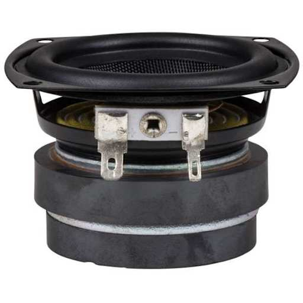
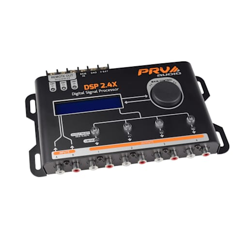
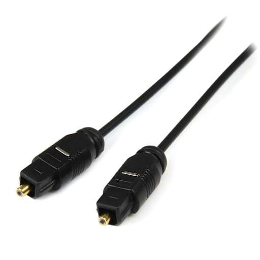

# Project: DIY Surround Sound with Laser Transmission

This project is a wireless surround sound system that uses **optical laser transmission** instead of traditional cables. The audio is converted to SPDIF/TOSLINK, transmitted by laser beams reflected off the ceiling and received by TOSLINK sensors in the speakers, which then play the sound through amplified Dayton drivers with per-channel DSP.

* A Dayton driver is an audio driver used to reproduce audio in a speaker.
* An audio DSP is a device that receives a digital or analog signal, processes it (equalization, crossovers, delays, etc.) and then sends the processed signal to the amplifiers.
* SPDIF is the digital interface standard (it can be coaxial – RCA – or optical, via TOSLINK).
* TOSLINK is the fiber-optic connector and cable used to transmit digital SPDIF, with red light inside the cable.

## Main components

### Audio and electronics

- Analog/digital SPDIF/TOSLINK converters (for transmission).
- TOSLINK/digital-to-analog converters (for reception).
- Low/midbass driver: **Dayton Audio TCP115-4** (4 ohms).
- Side channel tweeter: **Dayton Audio ND25FA-4**.
- Center channel tweeter: **Dayton Audio ND25FN-4**.
- **4-channel** amplifier.
- DSP (per-channel equalization and crossovers).
- Audio extraction via **HDMI** from the surround sound system.

- The DSP receives the digital signal, applies per-channel equalization, crossovers and delays, and delivers the processed signal to each amplifier.

- SPDIF/TOSLINK: digital optical interface used for lossless audio transmission between the modules.

### Laser transmission

- Low-power red laser diodes (class 1), used in place of the TOSLINK LED.
- TOSLINK sensors/receivers in the speakers.
- Adjustable mirrors to reflect the beam.
- 3D-printed parts to hold and adjust the mirrors.

### Speaker structure

- Acrylic tubes: 2 pieces of 1000 mm, 70 mm outer diameter and 66 mm inner.
- 3D-printed main cabinet, center channel, couplers, caps and ports.
- Mix of **plaster of Paris** with **PVA glue** for mass and damping.
- **Acoustic foam** and **sheep's wool** for internal damping.
- Glue for airtight sealing of the joints.
- Screws to assemble the parts.

### Finishing and assembly

- Filler/putty for finishing.
- Plastic primer.
- Paint with an **aged/textured iron** effect.
- Bamboo base/wooden foot for support.
- Wall mounts for the center channel.

### Tools and accessories

- Multi-function ratcheting screwdriver (e.g.: LTT Ratcheting Multi-bit Screwdriver).
- Connection terminals (block terminal).
- Power supply and cables for amplifiers and digital modules.

## Project goal

- Create a **surround sound system with no visible wires**, using laser reflection off the ceiling.
- Integrate per-channel DSP and equalization for better sound quality.
- Build rigid speakers with good mass using a combination of 3D-printed plastic, acrylic and filling.

# Bill of Materials

# Budget

# Estimated final budget — DIY Surround Sound with Laser Project

This document gathers a cost estimate for the project, assuming the cabinet parts will be printed by a specialized company, since no 3D printer is available. The values are approximate and serve as a basis for planning. The 3D printing price ranges and those of some components were obtained from sources consulted in this turn. [web:71][web:72][web:73][web:85][web:86][web:87][web:88]

## Assumptions

- Outsourced printing of all the project's 3D parts.
- Purchase of the audio components in Brazil or in Europe.

## Estimate by category

| Category | Included items | Estimated range |
| --- | --- | --- |
| Outsourced 3D printing | Cabinets, mounts, mirrors and structural parts | R$ 1.200 to R$ 1.500 |
| Electronics and audio | SPDIF/TOSLINK converters, Dayton drivers, amplifier, DSP and cables | R$ 3.300 to R$ 5.000 |
| Materials and finishing | Acrylic tubes, glue, foam, wool, primer, paint, screws and connectors | R$ 450 to R$ 900 |

## Component breakdown

| Component | Typical quantity | Estimated unit range | Estimated total |
| --- | --- | --- | --- |
| Analog → SPDIF/TOSLINK converter | 1 | R$ 70 to R$ 90 | R$ 80 |
| SPDIF/TOSLINK → analog converter | 3 to 4 | R$ 90 to R$ 130 | R$ 300 to R$ 500 |
| Dayton TCP115-4 | 4 to 5 | R$ 250 to R$ 350 | R$ 1.000 to R$ 1.750 |
| Dayton ND25FA-4 | 4 to 6 | R$ 120 to R$ 180 | R$ 500 to R$ 1.000 |
| Dayton ND25FN-4 | 1 to 2 | R$ 120 to R$ 180 | R$ 120 to R$ 360 |
| 4-channel amplifier | 1 to 2 | R$ 250 to R$ 500 | R$ 300 to R$ 800 |
| DSP | 1 | R$ 600 to R$ 1.200 | R$ 900 |
| Cables and mounting | 1 kit | R$ 80 to R$ 150 | R$ 100 |

## Estimated total

- **Approximate minimum total:** R$ 4.900
- **Approximate maximum total:** R$ 7.400
